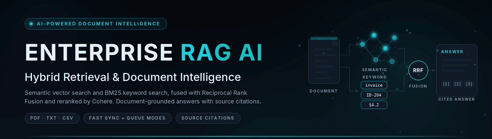
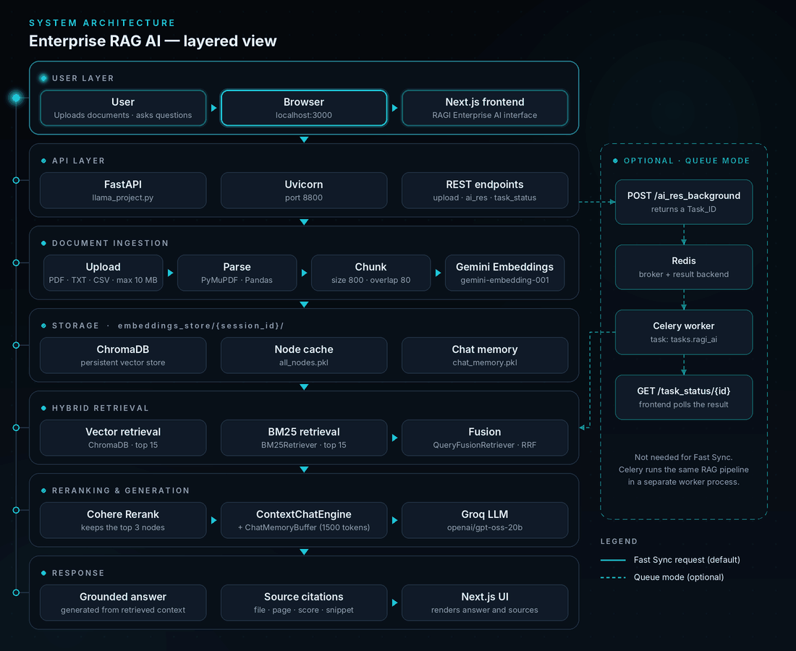

<div align="center">



# Enterprise RAG AI

**Hybrid Retrieval & Document Intelligence Platform**

Enterprise RAG AI i an AI-powered document intelligence platform that turns uploaded PDF, TXT and CSV files into searchable knowledge. Built with Python, FastAPI and LlamaIndex, it combines semantic vector retrieval, BM25 keyword search, Reciprocal Rank Fusion and Cohere reranking to generate document-grounded answers with source citations.

   
   
   

</div>

## Overview

| | |
|---|---|
| **What it does** | Turns uploaded documents into searchable knowledge. |
| **How it works** | Combines semantic search, keyword search, rank fusion and reranking. |
| **Why it is useful** | Reduces manual document searching and makes relevant passages easier to find. |
| **What you receive** | Context-grounded answers with source citations (file, page, relevance score, text snippet). |
| **Execution modes** | Direct synchronous requests, or optional background jobs with Celery and Redis. |

### Key capabilities

- **Document intelligence** — upload PDF, TXT or CSV files (up to 10 MB), extract the text, chunk it and embed it with Gemini into a session-specific ChromaDB store.
- **Hybrid retrieval** — semantic vector search and BM25 keyword search run together, then Reciprocal Rank Fusion and Cohere reranking select the best passages.
- **Grounded answers** — a LlamaIndex `ContextChatEngine` and a Groq LLM answer from the retrieved context, and the system prompt instructs the model to stay within the document.
- **Conversational memory** — each session keeps a 1500-token chat buffer, so follow-up questions retain context.
- **Two execution modes** — *Fast Sync* (default) and an optional *Background Queue*.
- **Session cleanup** — session folders are deleted automatically 10 minutes after creation.

## Quick Setup

### Option 1 — Run Everything with Docker Compose (Recommended)

Compose starts four services for you: **Redis**, the **FastAPI backend**, a **Celery worker** and the **Next.js frontend**.

**Prerequisites:** Git, Docker Desktop for Windows (**running**) and Docker Compose V2 (`docker compose version`).

**Step 1 — Clone the repository**

```powershell
git clone https://github.com/mrfaizan-dev/Enterprise-RAG-AI.git
cd Enterprise-RAG-AI
```

**Step 2 — Create your private `.env` file (before starting the containers)**

```powershell
Copy-Item .env.example .env
notepad .env
```

Replace the placeholders with your real API keys and **save the file** before continuing.

| Variable | Required | Purpose |
|---|---|---|
| `GEMINI_API_KEY` | Yes | Embeddings — [get a key](https://aistudio.google.com/) |
| `COHERE_API_KEY` | Yes | Reranking — [get a key](https://dashboard.cohere.com/) |
| `GROQ_API_KEYS` | Yes | LLM — [get a key](https://console.groq.com/). `GROQ_API_KEY` is accepted as a fallback. |
| `REDIS_URL` | Queue mode | Defaults to `redis://localhost:6379/0` |

The backend raises an error at startup if the Gemini, Cohere or Groq key is missing. `.env.example` is the public template; `.env` is your private file — never commit it or share it in screenshots.

**Step 3 — Build and start**

```powershell
docker compose up --build
```

The first build can take several minutes. **Do not start Python, Celery or npm separately** — Compose already runs them.

| Service | URL |
|---|---|
| Frontend | `http://localhost:3000` |
| FastAPI | `http://localhost:8800` |
| Swagger API Docs | `http://localhost:8800/docs` |
| Redis | `localhost:6379` |

**How `.env` reaches the containers:** `docker-compose.yml` has no `env_file` entry. Instead, it mounts the repository root into the backend and worker containers (`.:/app`), and `llama_project.py` calls `load_dotenv()`, which reads your `.env` from there. Compose sets `REDIS_URL=redis://redis:6379/0` itself, and `python-dotenv` does not override variables that already exist, so the `localhost` value in `.env` does not affect the containers.

**Stop:** press `Ctrl+C` to stop the attached session, then run `docker compose down` to stop and remove the containers and network.

```powershell
docker compose ps                  # check service status
docker compose logs -f backend     # follow backend logs
docker compose restart backend celery_worker   # after editing .env
```

### Option 2 — Run Locally on Windows PowerShell

Use this option only if you are **not** running Docker Compose. It uses the same root `.env` created in Option 1, Step 2.

**Prerequisites:** Python 3.12.x, Node.js 20.9 or later, npm, Git. Redis is needed only for the optional queue mode.

| Terminal | Process | Command | Keep running? |
|---|---|---|---|
| 1 | FastAPI backend | `python llama_project.py` | Yes |
| 2 | Next.js frontend | `npm run dev` | Yes |
| 3 | Optional Celery worker | `celery -A llama_project.celery_app worker --loglevel=info --pool=solo` | Yes, and needs Redis |

#### Terminal 1 — Python backend (repository root)

```powershell
py -3.12 -m venv .venv
.\.venv\Scripts\Activate.ps1
```

If PowerShell blocks activation, allow scripts for this window only, then activate again:

```powershell
Set-ExecutionPolicy -Scope Process -ExecutionPolicy Bypass
```

```powershell
python -m pip install --upgrade pip
pip install -r requirements.txt
python llama_project.py
```

`llama_project.py` has a `__main__` entry point that starts Uvicorn on port 8800. For development with auto-reload, use this command **instead** (not together with the one above):

```powershell
python -m uvicorn llama_project:app --host 127.0.0.1 --port 8800 --reload
```

Keep this terminal open.

#### Terminal 2 — Next.js frontend (open a new PowerShell window)

```powershell
cd scraper-frontend
npm install
```

The frontend reads `NEXT_PUBLIC_API_BASE_URL` and falls back to `http://127.0.0.1:8800`. To set it explicitly, create `scraper-frontend/.env.local`:

```powershell
notepad .env.local
```

```env
NEXT_PUBLIC_API_BASE_URL=http://127.0.0.1:8800
```

```powershell
npm run dev
```

Open `http://localhost:3000` and keep this terminal open.

#### Terminal 3 — Optional Celery worker (only for Queue Worker mode)

Fast Sync does **not** need Redis or Celery. Skip this terminal unless you want background jobs.

1. Make sure Redis is reachable at `redis://localhost:6379/0`. With Docker Desktop, start only Redis from the repository root: `docker compose up -d redis`. A local Redis-compatible service or Redis in WSL2 also works.
2. Open another PowerShell window in the repository root, activate the same environment and start the worker:

```powershell
.\.venv\Scripts\Activate.ps1
celery -A llama_project.celery_app worker --loglevel=info --pool=solo
```

Celery runs independently of FastAPI and uses Redis as its broker and result backend. Keep it running while using queue mode. Celery does not officially support native Windows, so the `solo` pool is a best-effort option for local development. Do not run this worker when you use Docker Compose — it already has its own.

## Architecture

<div align="center">

</div>

<sub>Static, high-resolution version: [`./architecture.svg`](./architecture.svg). The dashed branch is optional — normal Fast Sync requests never touch Redis or Celery.</sub>

## How the RAG Pipeline Works

<div align="center">

</div>

<sub>Static version: [`./workflow.svg`](./workflow.svg)</sub>

- **Semantic search vs. keyword search** — semantic search finds passages that are conceptually related to a question, even when the wording differs. BM25 finds exact words, identifiers and terminology. They complement each other.
- **Fusion and reranking** — each retriever returns its top 15 candidates. `QueryFusionRetriever` merges them with Reciprocal Rank Fusion, and Cohere reranking keeps the **top 3** nodes.
- **Answer generation** — `ContextChatEngine` sends those nodes and the session memory to a Groq model (`openai/gpt-oss-20b`, temperature 0.07).
- **Citations** — every answer returns the file name, page information where available, relevance score where available and a 150-character snippet.
- **CSV files** — each row becomes one searchable text node instead of being split into chunks, so the 60-node limit means a maximum of 60 rows.

## Technology Stack

| Area | Technologies |
|---|---|
| **Backend Engineering** | Python 3.12 · FastAPI · Uvicorn · Pydantic · python-dotenv |
| **AI & LLM Engineering** | LlamaIndex · Groq · GPT-OSS-20B (`openai/gpt-oss-20b`) · Google Gemini · Gemini Embedding 001 · Cohere Rerank · Tenacity |
| **Retrieval & Data** | ChromaDB · BM25Retriever · QueryFusionRetriever · Reciprocal Rank Fusion · PyMuPDF · Pandas |
| **Background Processing** | Celery · Redis |
| **Frontend Engineering** | Next.js 16 · React 19 · Tailwind CSS 4 · Framer Motion · Marked · React Icons |
| **Infrastructure** | Docker · Docker Compose |

### Engineering Capabilities Demonstrated

| | |
|---|---|
| Retrieval-Augmented Generation architecture | Hybrid information retrieval and search-result fusion |
| Document ingestion and preprocessing | Context reranking |
| Embedding generation | Session-based conversational memory |
| REST API development | Background task processing |
| Frontend and backend integration | Containerized application orchestration |
| Document provenance and citations | |

## Project Structure

```text
Enterprise-RAG-AI/
├── llama_project.py        # FastAPI app, RAG pipeline, Celery task
├── requirements.txt
├── .env.example            # public environment template
├── .gitignore
├── .gitattributes
├── .dockerignore
├── Dockerfile              # backend image
├── docker-compose.yml      # redis, backend, celery_worker, frontend
├── ./                 # README visuals (SVG + animated GIF)
│   ├── hero-banner.svg / .gif
│   ├── architecture.svg / .gif
│   ├── workflow.svg
│   ├── rag-pipeline.gif
│   └── faizan-signature.svg / .gif
└── scraper-frontend/       # Next.js frontend
    ├── app/                # page.js, layout.js, globals.css
    ├── package.json
    ├── package-lock.json
    ├── next.config.mjs
    └── Dockerfile
```

`embeddings_store/` is created at runtime to hold session data and is excluded from Git.

## API Reference

Interactive docs are available at `http://localhost:8800/docs`.

| Method | Endpoint | Purpose |
|---|---|---|
| POST | `/upload_document` | Upload and index a document |
| POST | `/ai_res` | Synchronous document question answering |
| POST | `/ai_res_background` | Submit a background question |
| GET | `/task_status/{task_id}` | Check a background task |

| Parameter | Used by | Where | Notes |
|---|---|---|---|
| `file` | `/upload_document` | multipart form data | `.pdf`, `.txt` or `.csv` |
| `my_session_id` | all question endpoints, optional on upload | query | A new ID is generated and returned if omitted on upload |
| `question` | `/ai_res`, `/ai_res_background` | query | The natural-language question |
| `task_id` | `/task_status/{task_id}` | path | Returned by `/ai_res_background` as `Task_ID` |

```powershell
curl.exe -X POST "http://localhost:8800/upload_document?my_session_id=demo" -F "file=@C:\path\to\document.pdf"
curl.exe -X POST "http://localhost:8800/ai_res?question=What%20is%20this%20document%20about&my_session_id=demo"
```

The answer response contains `status`, `answer` and a `citations` list (`source_index`, `file`, `page_number`, `relevance_score`, `snippet`).

## How to Use the Application

1. Start the application with Docker Compose (Option 1) or the local terminals (Option 2).
2. Open the frontend at `http://localhost:3000`.
3. Upload a PDF, TXT or CSV file.
4. Wait until indexing completes. Gemini embeddings are requested one chunk at a time with a short pause, so larger documents take longer.
5. Ask a question about the document.
6. Review the generated answer and its source citations.
7. Ask follow-up questions in the same session — the conversation memory keeps the context.
8. Choose **Fast Sync**, or **Queue Worker** when Redis and Celery are running.

Sessions are removed 10 minutes after they were created, so upload the document again after that.

## Technical & Security Notes

- The backend has **no authentication or authorization layer**, and CORS currently allows all origins.
- Uploaded document content is sent to external AI services (Gemini for embeddings, Cohere for reranking, Groq for answer generation).
- Session data (ChromaDB, cached nodes, memory) lives under `embeddings_store/`. Cleanup checks every 10 seconds and deletes a folder once 600 seconds have passed since its **original creation time** — this is not an inactivity timeout.
- Cached nodes and chat memory are stored as Python pickle files (`all_nodes.pkl`, `chat_memory.pkl`).
- The model is instructed to answer from the document context, but answers are not guaranteed to be accurate.
- Supported uploads: PDF, TXT and CSV, up to 10 MB and 60 chunks per file (chunk size 800, overlap 80).
- This project is a portfolio-grade implementation and should not be described as production-secure.

<br>

<div align="center">


**Designed & Built by Mr Faizan**<br>
AI Developer

[github.com/mrfaizan-dev](https://github.com/mrfaizan-dev)

</div>
