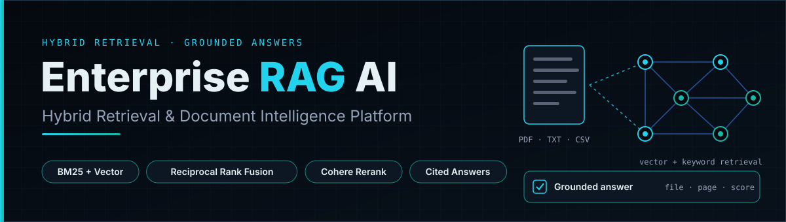
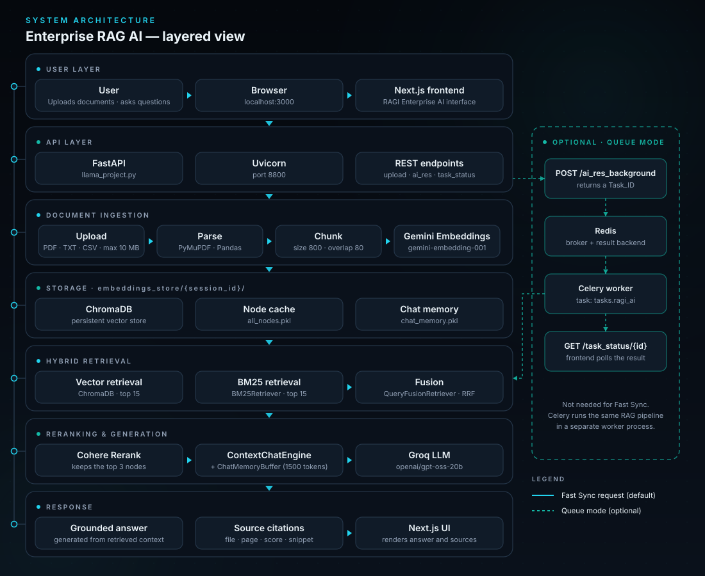
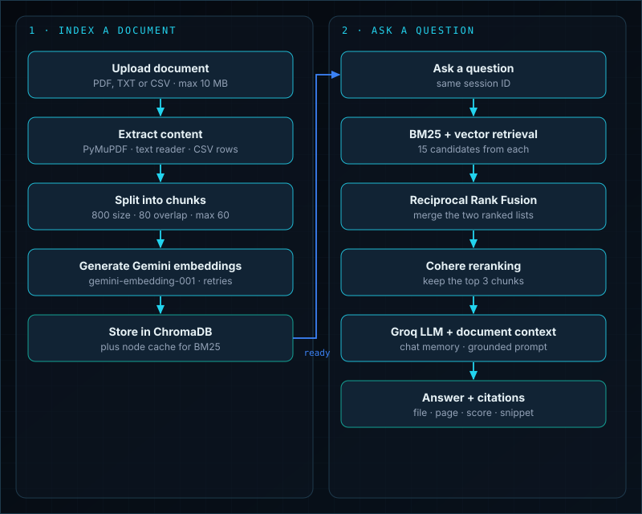
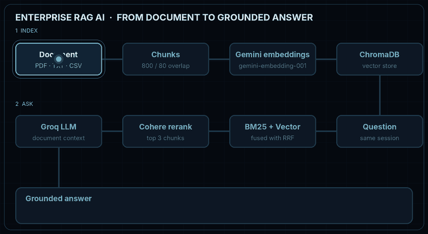

<p align="center">
  
</p>

<h1 align="center">Enterprise RAG AI</h1>

<p align="center">
  A document-grounded question-answering platform built with Python, FastAPI and LlamaIndex.<br>
  It combines semantic vector search, BM25 keyword retrieval, Reciprocal Rank Fusion and Cohere reranking<br>
  to answer questions from your uploaded documents, with source citations.
</p>

<p align="center">
  
  
  
  
  
  
  
  
  
  
  
  
  
</p>

---

## What is Enterprise RAG AI?

Enterprise RAG AI lets you upload a document, ask questions about it, and get an answer based on that document.

RAG means *Retrieval-Augmented Generation*. The app first finds the most relevant parts of your document. Then a language model writes the answer using only those parts. Each answer comes with citations so you can check the source.

The web interface is called **RAGI Enterprise AI**. It is built with Next.js and talks to a FastAPI backend.

## What problem does it solve?

Reading long PDFs, text files and spreadsheets to find one fact is slow. A plain chatbot can also answer from general knowledge instead of your file.

This project narrows the model to your document. It retrieves relevant passages, ranks them, and instructs the model to answer only from that context.

## Key features

- **Upload PDF, TXT and CSV files** (up to 10 MB, up to 60 chunks per file).
- **Hybrid retrieval:** semantic vector search (ChromaDB) plus BM25 keyword search.
- **Reciprocal Rank Fusion** merges the two ranked result lists.
- **Cohere reranking** keeps the 3 most relevant chunks.
- **Document-grounded prompt:** the model is told to refuse when the document has no answer.
- **Source citations:** file name, page (when available), relevance score and a text snippet.
- **Session memory:** follow-up questions in the same session keep context (1500-token buffer).
- **Two query modes:** Fast Sync (default) and an optional Celery + Redis Queue Worker mode.

## Architecture

<p align="center">
  
</p>

The queue branch at the bottom is optional. Normal requests go straight through FastAPI.

## How the RAG workflow works

1. **Upload.** The file is read (PyMuPDF for PDF, a text reader for TXT, Pandas for CSV).
2. **Chunk.** PDF and TXT text is split with `SentenceSplitter` (chunk size 800, overlap 80). Each CSV row becomes one text node.
3. **Embed.** Each chunk is embedded with Google Gemini `gemini-embedding-001`, with exponential retries.
4. **Store.** Vectors go into a session-specific ChromaDB collection. The nodes are also cached for BM25.
5. **Retrieve.** A question runs through both BM25 (keyword match) and Chroma vector search (meaning match), up to 15 candidates each.
6. **Fuse.** Reciprocal Rank Fusion merges the two lists.
7. **Rerank.** Cohere reranks the fused list and keeps the top 3 nodes.
8. **Answer.** LlamaIndex `ContextChatEngine` sends the context and chat memory to the Groq model `openai/gpt-oss-20b`.
9. **Cite.** The API returns the answer plus citation metadata.

**Why both search types?** Semantic search understands meaning, even when the wording differs. BM25 is strong at exact terms such as names, codes and keywords. Fusing and reranking them gives the model better context than either method alone.

<p align="center">
  
</p>

<p align="center">
  <br>
  <sub>Illustrative animation of the pipeline. Citation values shown are sample text, not a real screenshot.</sub>
</p>

## Technology stack

| Area | Technologies |
|---|---|
| Backend | Python 3.12, FastAPI, Uvicorn, Pydantic, python-dotenv |
| AI and LLM | LlamaIndex, Groq (`openai/gpt-oss-20b`), Google Gemini (`gemini-embedding-001`), Cohere Rerank, Tenacity |
| Retrieval and storage | ChromaDB, BM25Retriever, QueryFusionRetriever (Reciprocal Rank Fusion), PyMuPDFReader, Pandas |
| Background processing | Celery, Redis (optional queue mode) |
| Frontend | Next.js 16, React 19, Tailwind CSS 4 |
| Infrastructure | Docker, Docker Compose (optional) |

## Project structure

```text
Enterprise-RAG-AI/
├── llama_project.py        # FastAPI app, RAG pipeline, Celery task
├── requirements.txt
├── .env.example            # template, safe to publish (placeholders only)
├── .gitignore
├── .gitattributes
├── .dockerignore
├── Dockerfile
├── docker-compose.yml
├── ./
│   ├── hero-banner.svg
│   ├── architecture.svg
│   ├── workflow.svg
│   └── rag-pipeline.gif
└── scraper-frontend/       # Next.js app (RAGI Enterprise AI)
    ├── app/                # page.js, layout.js, globals.css
    ├── public/
    ├── package.json
    ├── next.config.mjs
    └── Dockerfile
```

- `.env.example` is the shared template with placeholder values.
- `.env` is your private local file with real keys. It is never committed.

## Requirements

- Windows with PowerShell
- Git
- Python 3.12 (the Dockerfile uses 3.12.8)
- Node.js 20.9 or later
- API keys for Gemini, Cohere and Groq (see below)
- Redis (only for optional queue mode)

## Windows setup

Follow the steps in this order:

**Clone → Create `.env` → Add API keys → Install dependencies → Start backend → Start frontend**

### 1. Clone the repository

```powershell
git clone https://github.com/mrfaizan-dev/Enterprise-RAG-AI.git
cd Enterprise-RAG-AI
```

### 2. Create `.env` and add your API keys

Do this **before** starting the backend. The backend reads its keys when it starts and stops with an error if any are missing.

```powershell
# Run inside the project root, next to llama_project.py
Copy-Item .env.example .env

# Open the new file
notepad .env
```

1. `.env.example` is the template from GitHub. Leave it unchanged.
2. `Copy-Item` creates a separate `.env` file from it.
3. Replace each placeholder with your real key and save the file.

Already have a `.env`? Do not overwrite it. Just run `notepad .env`.

Your final file should look like this:

```env
GEMINI_API_KEY=your_actual_gemini_api_key
COHERE_API_KEY=your_actual_cohere_api_key
GROQ_API_KEYS=your_actual_groq_api_key
REDIS_URL=redis://localhost:6379/0
```

Do not add quotation marks around the keys.

| Variable | Purpose | Required |
|---|---|---|
| `GEMINI_API_KEY` | Creates document and query embeddings | Yes |
| `COHERE_API_KEY` | Reranks retrieved chunks | Yes |
| `GROQ_API_KEYS` | Authenticates the Groq LLM | Yes |
| `REDIS_URL` | Redis address for Celery | Only for queue mode (defaults to `redis://localhost:6379/0`) |

The backend also accepts a single `GROQ_API_KEY` as a fallback when `GROQ_API_KEYS` is empty. `GROQ_API_KEYS` is split on commas, but the LLM client is created once at startup, so only the first key is used. One valid key is enough.

**Get your keys:**

- [Google AI Studio](https://aistudio.google.com/) for the Gemini key
- [Cohere Dashboard](https://dashboard.cohere.com/) for the Cohere key
- [Groq Console](https://console.groq.com/) for the Groq key

**Key safety:** `.env` is listed in `.gitignore`. Never commit or share it. If a key is exposed, revoke or rotate it right away.

### 3. Create a Python virtual environment

```powershell
py -3.12 -m venv .venv
.\.venv\Scripts\Activate.ps1
```

If PowerShell blocks activation, run this once, then activate again:

```powershell
Set-ExecutionPolicy -Scope Process -ExecutionPolicy Bypass
```

### 4. Install backend requirements

```powershell
python -m pip install --upgrade pip
pip install -r requirements.txt
```

### 5. Start the backend

```powershell
python -m uvicorn llama_project:app --host 127.0.0.1 --port 8800 --reload
```

- API: `http://127.0.0.1:8800`
- Swagger docs: `http://127.0.0.1:8800/docs`

Keep this terminal open.

### 6. Start the frontend (new PowerShell terminal)

```powershell
cd Enterprise-RAG-AI\scraper-frontend   # or just: cd scraper-frontend
npm install
```

The frontend reads `NEXT_PUBLIC_API_BASE_URL` and falls back to `http://127.0.0.1:8800`. To set it explicitly, create `scraper-frontend/.env.local` **before** starting the dev server:

```env
NEXT_PUBLIC_API_BASE_URL=http://127.0.0.1:8800
```

```powershell
npm run dev
```

Open `http://localhost:3000`.

## How to use the app

1. Open the frontend in your browser.
2. Upload a PDF, TXT or CSV file.
3. Wait for processing and embedding.
4. Ask a question about the document.
5. Read the answer and its citations.
6. Keep asking in the same session.

Choose **Fast Sync** (default, no Redis needed) or the optional **Queue Worker** mode.

Indexing can take a while. Embeddings are requested one chunk at a time with a short pause, so a file near the 60-chunk limit may take two minutes or more.

## API reference

| Method | Endpoint | Purpose |
|---|---|---|
| POST | `/upload_document` | Upload and index a PDF, TXT or CSV file |
| POST | `/ai_res` | Ask a question (synchronous) |
| POST | `/ai_res_background` | Send a question to the Celery queue |
| GET | `/task_status/{task_id}` | Get Celery task status and result |

**Parameters**

- `file`: multipart form field on `/upload_document`.
- `my_session_id`: query parameter. Optional on upload (a UUID is generated if missing, and returned as `session_id`). Required on `/ai_res` and `/ai_res_background`.
- `question`: query parameter on `/ai_res` and `/ai_res_background`.
- `task_id`: path parameter on `/task_status/{task_id}`.

```powershell
curl.exe -X POST "http://127.0.0.1:8800/upload_document?my_session_id=demo" -F "file=@sample.pdf"
curl.exe -X POST "http://127.0.0.1:8800/ai_res?question=Summarize%20this%20document&my_session_id=demo"
```

## Optional: background queue mode

Queue mode is not needed for Fast Sync. It requires a running Redis server reachable at `REDIS_URL`.

With the virtual environment active, start a worker in a separate terminal:

```powershell
celery -A llama_project.celery_app worker --loglevel=info --pool=solo
```

Celery does not officially support Windows. The `solo` pool is a best-effort option for local development and may not work on every setup.

## Operational and security notes

- Keep API keys private. `.env.example` is safe to publish; `.env` is not.
- The backend has **no authentication or authorization**, and CORS allows all origins.
- Document text is sent to external providers: Google (embeddings), Cohere (reranking) and Groq (answer generation).
- Session data lives locally under `embeddings_store/<session_id>/` (ChromaDB data, cached nodes, chat memory).
- A cleanup task checks every 10 seconds and deletes a session folder 600 seconds after its **original creation time**. The timer is not reset by activity.
- Limits: PDF, TXT and CSV only; 10 MB per file; 60 chunks per file (a CSV with more than 60 rows is rejected).
- The prompt instructs the model to answer only from the document. This reduces unsupported answers but does not guarantee them.
- Citations include a page value only when the source metadata has one.

<details>
<summary>Optional: Run with Docker Compose</summary>

<br>

Docker is secondary. Use the Windows setup above if you want the simplest path.

`docker-compose.yml` starts Redis, the backend (port 8800), a Celery worker and the frontend (port 3000).

**Important:** the Compose file sets only `REDIS_URL` for the backend. It does not pass `GEMINI_API_KEY`, `COHERE_API_KEY` or `GROQ_API_KEYS`, and the backend needs all three at startup. The project folder is mounted into the container at `/app`, so a `.env` file in the project root should be picked up by `load_dotenv()`. This path has not been verified end to end, so do not treat Compose as working out of the box.

1. Create `.env` from `.env.example` and add your keys (see step 2 above).
2. Start the stack:

```powershell
docker compose up --build
```

3. Open `http://localhost:3000`. Swagger docs are at `http://127.0.0.1:8800/docs`.

</details>

---

<p align="center">
  <sub>Designed &amp; Built by <a href="https://github.com/mrfaizan-dev"><b>Mr Faizan</b></a> &nbsp;|&nbsp; AI Engineer</sub>
</p>
